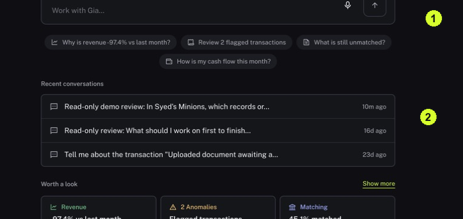

Use Ask to frame a question, read the answer and open the evidence behind it. A useful answer should help you decide where to look next.

<Tip>
**Example:** Ask which Matches need attention this month, then check a cited record and the actual Needs attention list.
</Tip>

<Info>
**Before you start:** Choose a specific date range and topic. A citation is a link to supporting information; one citation supports its example, not every claim in an answer.
</Info>

<Frame caption="1 Enter a scoped question. 2 Recent conversations let you reopen earlier work.">
  
</Frame>

## Step by step

1. Click Ask in the sidebar and place the cursor in Work with Gia, the message box on the page.
2. Write one question. Include the period, the account or counterparty and the decision you are trying to make. For example: "For August 2026, which Matches need attention? List the reasons and link the supporting records."
3. Add "State the sources and date range you used, and tell me what is missing." If you are investigating only, add "Do not change any records."
4. Click Send message and wait for the response. Keep the conversation open while Gia is working.
5. Read the answer's scope before its conclusion. Check dates, currency, accounts and whether the response covers the full request or only examples.
6. Use a follow-up in the same conversation to clarify a specific point, such as "Which evidence is missing from the first Match?" Follow [Check an answer against its evidence](/gia/check-evidence) before relying on the answer.

<Check>
**Expected result:** You have a response to a specific question and a clear next source or record to inspect.
</Check>

<Warning>
**If you get stuck:** If the answer is vague, ask for exact dates and sources. If it conflicts with the live queue, investigate the conflict instead of treating the answer as confirmation.
</Warning>

<Note>
Do not assume that a conversational statement means Nini performed a posting, approval or other change.
</Note>
