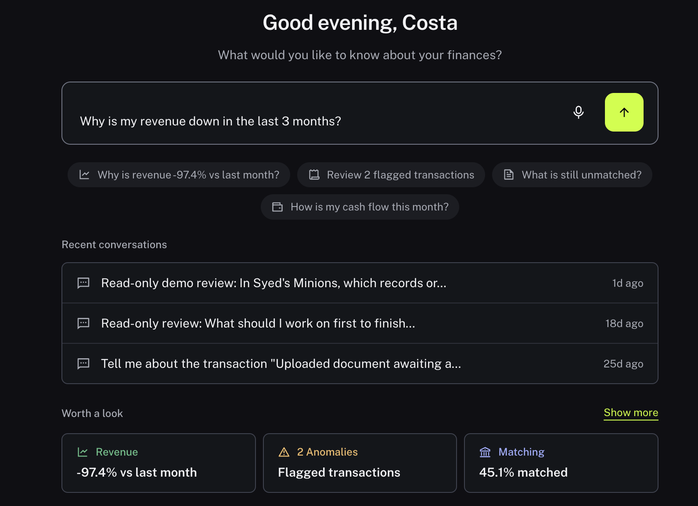

Use Gia to investigate your financial information in everyday language. These pages explain what it can help with, how to ask a useful question, how to follow the evidence and how to continue a conversation while working elsewhere in Nini.

<Frame>
  
</Frame>

Gia is Nini's AI analyst. Ask a question in everyday language to help investigate the information brought into Nini. It can help you find a starting point, summarize activity and identify evidence to inspect. Its usefulness depends on the connected sources, their freshness and what information is available in the current organization.

<Tip>
**Example:** Instead of opening every record yourself, ask which supplier payments in a specific month need attention and request links to the supporting evidence.
</Tip>

<Info>
**Before you start:** Confirm the current organization and the time period you want to investigate. Connect or upload the relevant information first if Nini does not have it yet.
</Info>

## Step by step

1. Open Ask under Insights in the sidebar.
2. Read the suggested questions and Worth a look items, when present. These are starting points for an investigation, not a complete list of everything that needs attention.
3. Decide what you want to learn: find an item, explain a change, summarize a period or identify exceptions. Name the account, supplier or period that matters.
4. Check whether the source you need is available in Accounts, Integrations or Documents. An answer cannot establish the contents of a file or system that has not been brought into the relevant workspace.
5. Ask for evidence and scope with the answer. Then use [Ask a clear question](/gia/ask-a-question) to send the question and [Check an answer against its evidence](/gia/check-evidence) to check the response.

<Check>
**Expected result:** You have a focused question and know which source information it depends on.
</Check>

<Warning>
**If you get stuck:** If Gia gives a broad answer, narrow the question to one account, supplier or date range. Ask what sources and dates it used and what information is missing.
</Warning>

## Useful questions to try

- Find evidence: "Find the invoice supporting the CAD 900 payment to Example Supplies on 15 August 2026. Link the invoice and bank item."
- Review work: "For August 2026, list Matches needing attention and explain each reason. Include links and identify any missing sources."
- Explain a change: "Compare this month's supplier payments with last month's. State the date ranges, currency and accounts included."
- Summarize: "Summarize the activity in this account for August 2026. Separate what the records show from your interpretation."

<Note>
Example prompts are suggestions, not promises of a particular answer. Gia's conclusions are investigative guidance, not assurance that bookkeeping is accurate.
</Note>
