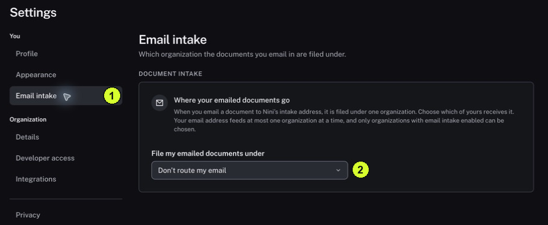

One address routes to at most one organization at a time.

<Tip>
**Example:** You work with two organizations. Check the routing choice before emailing a receipt so it is filed under the intended organization.
</Tip>

<Info>
**Before you start:** Email intake must be enabled for the destination organization, and you need a Bookkeeper, Controller or Admin role there. Membership in an organization alone is not sender enrollment.
</Info>

<Frame caption="1 Email intake is under You. 2 The selector shows the current routing choice.">
  
</Frame>

## Step by step

1. Click Settings, then click Email intake under You. If it is absent, ask an administrator about availability and access.
2. Read File my emailed documents under. Don't route my email means no organization is selected for that address.
3. For setup, choose the intended enabled organization and confirm the displayed selection. Ask your administrator to resolve missing enrollment or confirmation requirements.
4. Open Documents → Upload in your own environment and read its intake address. Do not use the masked address from this guide.
5. For an agreed first test, send one suitable sample from the enrolled address to that intake address.
6. Return to Documents → Browse in the destination organization and locate the sample. Open it to confirm the organization and file are correct.

<Check>
**Expected result:** The intended result is that the sample arrives under the selected organization and can be inspected.
</Check>

<Warning>
**If you get stuck:** If it does not arrive, check the sending address, routing selection, organization enablement and confirmation state before resending. Pending confirmation is not active enrollment.
</Warning>
