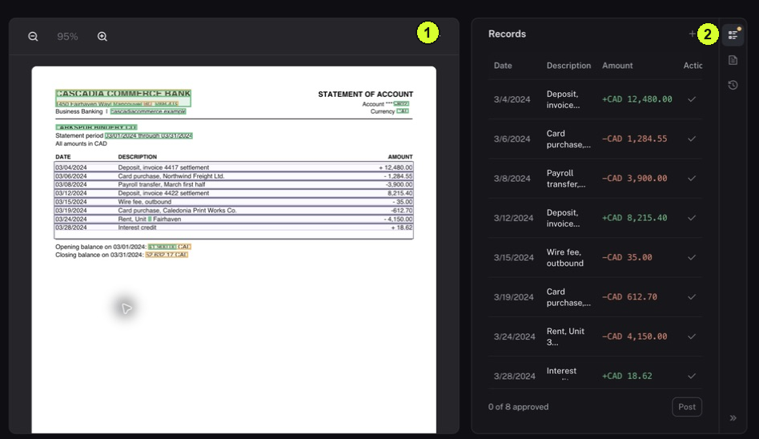

Reviewing means checking those records against the original so an extraction mistake does not become part of later work.

<Tip>
**Example:** A bank statement has eight transaction lines. Check all eight, including whether a withdrawal has been read with the correct sign and date.
</Tip>

<Info>
**Before you start:** Open Documents → Browse and find the file. Have a readable original. A confidence score estimates extraction confidence; it does not replace your review.
</Info>

<Frame caption="1 Inspect the source preview. 2 Review the extracted records and the pane controls.">
  
</Frame>

## Step by step

1. Open the file and choose Open full page when available. You should see the source preview and a Records pane, as illustrated.
2. Use zoom or rotation if needed to read the original. Start with its first transaction or invoice item.
3. Find the corresponding extracted record. Compare the date and year, description, amount, plus or minus sign, and currency. Repeat for every record.
4. Open Document details for classification and metadata. Use History to inspect earlier events. If information is wrong or missing, have it corrected through your agreed review process before completing review.
5. When carrying out an authorized review, use the available Approve or Reject control for each record. The illustrated Post control is disabled until every record is approved or rejected.
6. Read any remaining explanation beside Post. Before posting, confirm the next action with your established workflow; then inspect the resulting state rather than assuming the review and posting are the same step.

<Check>
**Expected result:** You can explain whether each extracted record agrees with the original and identify anything that needs correction.
</Check>

<Warning>
**If you get stuck:** If Post is disabled, check for a record without a review decision and read the button's explanation. Do not approve incorrect data just to enable Post.
</Warning>
