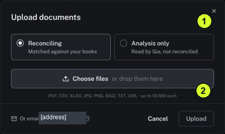

The destination tells Nini whether to use it for reconciliation, meaning comparing and connecting financial evidence, or for analysis only.

<Tip>
**Example:** A supplier invoice to compare with a payment belongs in Reconciling. A background report you want Gia to read may belong in Analysis only.
</Tip>

<Info>
**Before you start:** Have the correct file ready and check whether it is already in Documents. Supported formats shown are PDF, CSV, XLSX, JPG, PNG, BAI2, TXT and XML, up to 50 MB per file.
</Info>

<Frame caption="1 Choose Reconciling or Analysis only. 2 Check the supported formats and per-file limit.">
  
</Frame>

## Step by step

1. Click Documents in the sidebar, then click Upload.
2. Read the two choices at the top of the dialog. Select Reconciling for a file to be matched against your books, or Analysis only for a file Gia reads without reconciliation.
3. Click Choose files and select your file, or drag it into the drop area.
4. Check the selected file and destination before clicking Upload. If either is wrong, correct your selection first.
5. After submitting, wait for the app's processing result. Open Documents → Browse and look for the file under the destination you chose.
6. Open the file and review its contents using [Review information extracted from a document](/guides/documents/review-extracted-information). A successful submission is not the same as a completed review.

<Check>
**Expected result:** The intended result is a file you can locate in Documents and inspect in the correct destination.
</Check>

<Warning>
**If you get stuck:** If the file is missing or fails, check format, size, Destination and status filters, then read any error. Do not repeatedly upload the same file.
</Warning>
