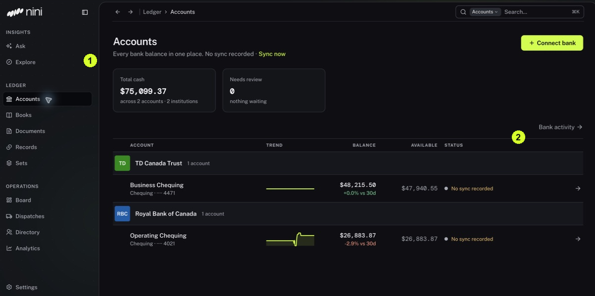

A tab changes the view inside an area, and a filter limits which items are shown. Knowing the difference makes it easier to find an item without changing it.

<Tip>
**Example:** To inspect an original invoice, start in Documents. To see the invoice together with a bank payment, start in Records and choose Matches.
</Tip>

<Info>
**Before you start:** A path such as Records → Browse → Matches means click Records, then Browse, then Matches. A drawer is a panel that opens beside the list.
</Info>

<Frame caption="1 The sidebar groups destinations. 2 Connection status is shown beside each account.">
  
</Frame>

## Step by step

1. Find the left sidebar shown at marker 1. Click Accounts for bank information, Books for accounting connections and posting, Documents for files, Records for review work, or Sets for related events.
2. Click the area you need. Read its heading to confirm where you are before using its controls.
3. If the page has Overview and Browse tabs, use Overview for a summary or work queue and Browse for the wider list.
4. In Records → Browse, choose Records for individual items or Matches for grouped evidence. These are two views within Records.
5. Check any Dates, Date range, Destination or Filters controls. A filter can hide an item that exists.
6. Use the sidebar to move to another area. Use a drawer's close button to return to the list behind it.

<Check>
**Expected result:** You can open the right area and recognize when a tab or filter changes what you see.
</Check>

<Warning>
**If you get stuck:** If a menu is absent, ask your administrator about access and feature availability. Operations is optional. A missing menu does not mean your data was deleted.
</Warning>
