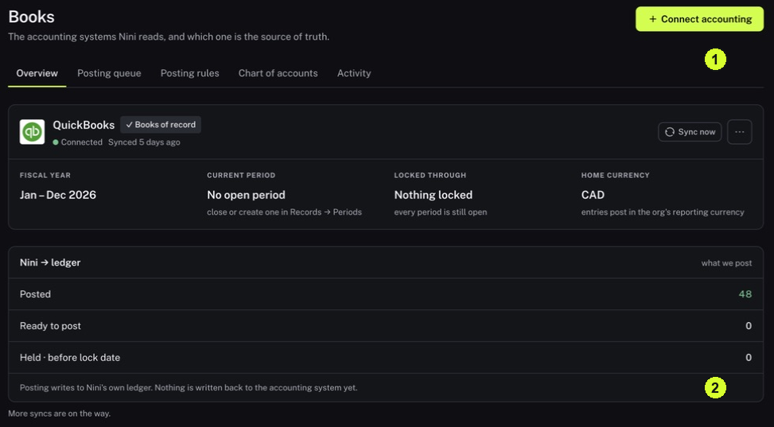

It also shows work waiting for Nini's ledger.

<Tip>
**Example:** You see a posted item in Nini but cannot find a new entry in QuickBooks. Books explains the destination of posting before you assume that a transfer failed.
</Tip>

<Info>
**Before you start:** Know which accounting provider your organization uses. QuickBooks Desktop and QuickBooks Online are different connections and need different setup or recovery instructions.
</Info>

<Frame caption="1 Books has Overview and Posting queue tabs. 2 Read the Nini ledger posting explanation.">
  
</Frame>

## Step by step

1. Click Books in the sidebar, then click Overview.
2. Read the provider name, connection status and last displayed sync. Identify the source marked Books of record.
3. Read the fiscal year, current period, lock information and home currency. These describe the accounting context for the screen.
4. Read the posting explanation. In the reviewed release, posting writes to Nini's own ledger; nothing is written back to the accounting system yet.
5. Click Posting queue to see items waiting to reach the ledger. Review the displayed state before deciding what action is needed.
6. Return to Records → Browse → Matches to check evidence warnings. An empty posting queue does not establish that every Match has complete evidence.

<Check>
**Expected result:** You know which accounting source Nini is using and where a Nini posting goes.
</Check>

<Warning>
**If you get stuck:** If the provider or currency is unexpected, confirm the organization and ask your accounting administrator. Do not add another connection simply to make the screen look right.
</Warning>
