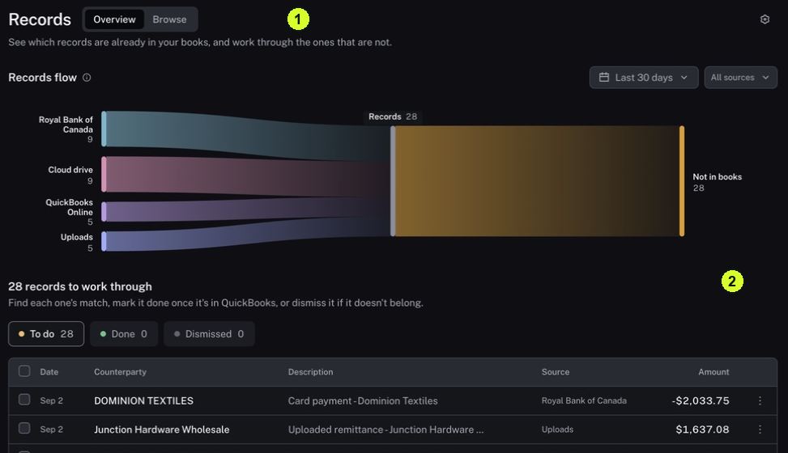

Overview helps you find review work; Browse lets you inspect the wider list.

<Tip>
**Example:** You want to know which imported items still need someone to look at them. Start with To do for the period you are responsible for.
</Tip>

<Info>
**Before you start:** Choose the period and source you want to review. A record can already belong to a Match and still need attention.
</Info>

<Frame caption="1 Switch between Overview and Browse. 2 Use the work queue below the flow.">
  
</Frame>

## Step by step

1. Click Records in the sidebar, then click Overview.
2. Check the period and Sources controls above Records flow. The flow summarizes information within that selected scope.
3. Below the flow, click To do to see the work list. Done and Dismissed show other review states.
4. Find an item. Open its Row actions menu and choose Open full details. A matched item may open its Match page.
5. Read the item's source, date, amount and related evidence. Use [Inspect the evidence and status of a Match](/guides/records/inspect-a-match) if grouped evidence appears.
6. To inspect the wider list, return to Records and click Browse, then Records. Choose All, Unmatched or Matched and check Date range and Filters.

<Check>
**Expected result:** You have opened a specific item for review and know the period, source and status filter used to find it.
</Check>

<Warning>
**If you get stuck:** If the list is empty, check the period and source before concluding there is no work. Compare counts only when dates, filters and the type of item counted match.
</Warning>

<Note>
Mark done, Dismiss and Remove from reconciliation change an item's state. Use them only when your review process calls for that decision; they are not ways to open or inspect a record.
</Note>
