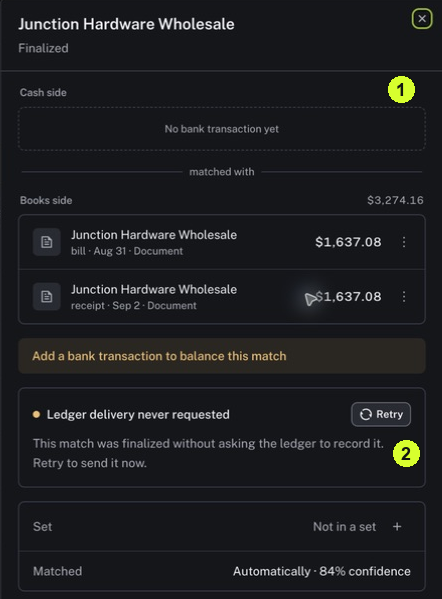

Reading all three helps you identify the actual next problem to solve.

<Tip>
**Example:** The pictured Match is Finalized but has no bank transaction and says Ledger delivery never requested. Finalized alone does not mean evidence is complete or delivery happened.
</Tip>

<Info>
**Before you start:** Open Records → Browse → Matches and click Review on a row. Cash side refers to bank evidence; Books side contains the related accounting or document records.
</Info>

<Frame caption="1 Check whether the cash side has evidence. 2 Read the ledger-delivery message before using Retry.">
  
</Frame>

## Step by step

1. Read the Match name and status at the top of the drawer.
2. Read Cash side. Identify the bank record, or note the missing-bank message if no record is present.
3. Read each Books side record. Compare the party, date, amount, currency and money direction with the cash evidence. Equal amounts alone do not prove they belong together.
4. Read any evidence warning, such as a missing bank transaction or conflicting directions. Write down which specific evidence needs investigation.
5. Read the ledger-delivery message separately. Distinguish posted, failed and never requested messages; do not infer delivery from Finalized.
6. For more context, use History and Details on the full Match page. Close the drawer to return to the list when you have identified the issue.

<Check>
**Expected result:** You can state whether the problem is missing evidence, conflicting evidence, ledger delivery or more than one of these.
</Check>

<Warning>
**If you get stuck:** Retry sends the Match to the ledger in the illustrated message; it does not merely reload the page. Resolve the evidence and confirm the intended action before using it.
</Warning>

<Note>
Nini ledger posting is separate from writing back to external accounting software.
</Note>
