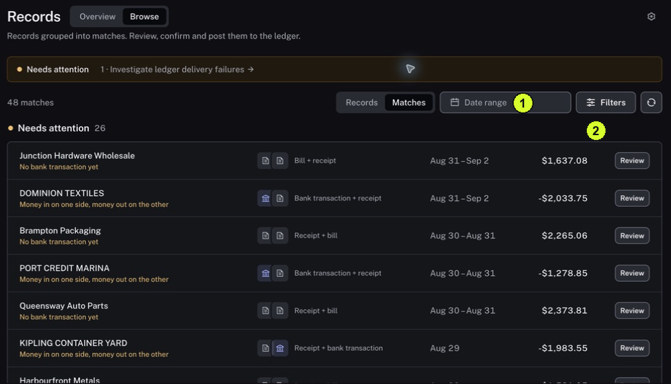

The Matches view helps you find missing evidence, conflicting information or a delivery issue that needs investigation.

<Tip>
**Example:** An invoice and receipt are grouped together but no bank payment is attached. The warning No bank transaction yet tells you what evidence is missing.
</Tip>

<Info>
**Before you start:** Have the period you want to review. Needs attention, Ready to post and Posted are groups to inspect, not a single guarantee that all checks passed.
</Info>

<Frame caption="1 Choose Matches within Browse. 2 Review the attention reasons and open a row.">
  
</Frame>

## Step by step

1. Click Records in the sidebar.
2. Click Browse at the top of the page, then choose Matches beside Records.
3. Check Date range and Filters. Set the scope you intend to review.
4. Find the Needs attention group. Read the reason under each item, such as No bank transaction yet, conflicting money directions or Ledger delivery failed.
5. Click Review on one row. A drawer opens so you can inspect the Match without leaving the list.
6. Follow [Inspect the evidence and status of a Match](/guides/records/inspect-a-match) to compare the evidence and delivery message. Close the drawer using its X to return to the list and inspect the next item.

<Check>
**Expected result:** You know why one Match needs attention and have opened the evidence behind that reason.
</Check>

<Warning>
**If you get stuck:** If no items appear, check dates and filters. If a Posted item has a warning, inspect it: posting and evidence quality are separate.
</Warning>
