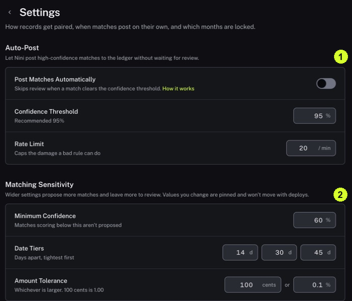

Closed Periods is used to protect dates from further changes. These settings affect more than the item you are viewing.

<Tip>
**Example:** A looser date tolerance may propose more possible Matches. A closed month may prevent a later edit to a record dated inside it.
</Tip>

<Info>
**Before you start:** Use this section to understand the current setup. An accounting administrator should decide changes under your organization's review policy.
</Info>

<Frame caption="1 Auto-Post controls automatic delivery. 2 Matching Sensitivity controls proposed Matches.">
  
</Frame>

## Step by step

1. Click Records in the sidebar, then open the Matching settings link in the page header.
2. Read Auto-Post and the Post Matches Automatically switch. Confidence Threshold is the confidence level used by that setting; Rate Limit caps the number processed per minute.
3. Read Matching Sensitivity. Minimum Confidence affects which suggestions are proposed; Date Tiers sets date gaps; Amount Tolerance allows a stated difference in amounts.
4. Read the units beside each value. For example, cents, percent and days measure different things. A higher number does not always mean a stricter check.
5. Use Books of Record → Manage if you need to inspect Books. Return to Matching settings for period controls.
6. Scroll down to Closed Periods. Read any existing periods and the lock explanation. The screen states that closing locks matching, finalization, editing and re-pulling for dates within the period.

<Check>
**Expected result:** You can describe the current matching and posting controls and identify whether a relevant period is locked.
</Check>

<Warning>
**If you get stuck:** If Books helper text directs you to Records → Periods, use Matching settings → Closed Periods in the reviewed layout. Ask an administrator before changing a lock.
</Warning>
