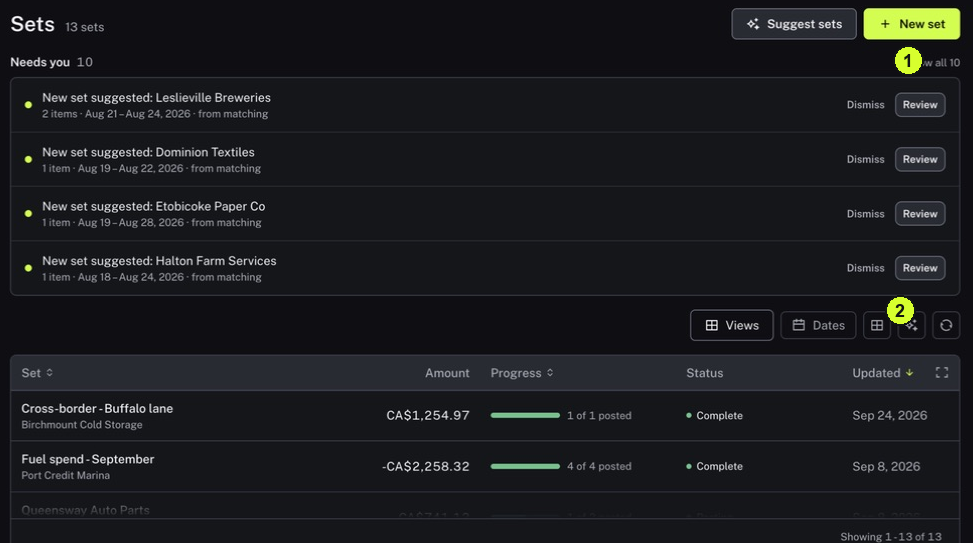

A Match explains one event; a Set explains why several events belong together. Checking the group's membership helps you view related work without losing the evidence for each event.

<Tip>
**Example:** A project has several supplier payments. A Set can collect those Matches so you can review the project's members together.
</Tip>

<Info>
**Before you start:** Know the project or other context you are looking for. A Set's membership review and the financial review of each Match are different tasks.
</Info>

<Frame caption="1 Needs you contains membership suggestions. 2 Inspect the existing Set list and progress.">
  
</Frame>

## Step by step

1. Click Sets in the sidebar. Find the existing Set in the list and open it.
2. Read its name and description to confirm the business context. Read Net amount and the posted or open counts as separate measures.
3. Use All, Needs attention, Matched or Open to choose which members to inspect.
4. Click Open beside a member to review its Match. Check that it belongs in the Set and that its own evidence is sound.
5. For a suggested Set, return to the Sets list and click Review under Needs you. Read Why these belong together and inspect the proposed members before accepting any grouping.
6. Before interpreting a total, check which Matches are included and what the amount measures. Do not automatically add totals from overlapping Sets.

<Check>
**Expected result:** You understand the Set's purpose and can explain why the inspected Matches belong in it.
</Check>

<Warning>
**If you get stuck:** If a Set looks complete but still needs attention, check membership suggestions as well as member Match warnings. Posted members do not settle every membership question.
</Warning>

<Note>
Do not treat displayed Set totals as a simple sum of cash movements.
</Note>
