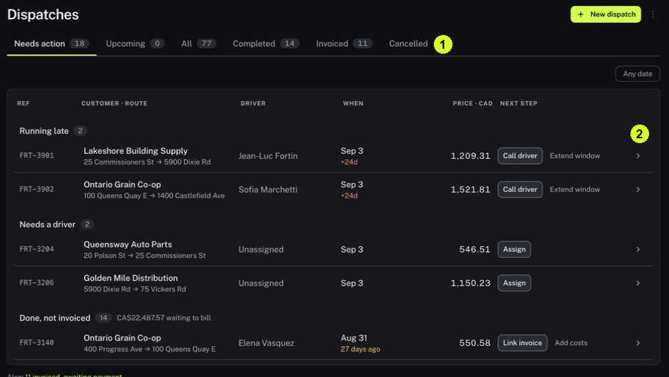

It helps you identify whether a job is late, unassigned or completed without an invoice.

<Tip>
**Example:** A job appears under Done, not invoiced. Open it to inspect the work and linked records before deciding how to handle invoicing.
</Tip>

<Info>
**Before you start:** Operations must be enabled. Read a job's next-action label before selecting a control that changes it.
</Info>

<Frame caption="1 Select the dispatch queue. 2 Open a dispatch to examine its details.">
  
</Frame>

## Step by step

1. Click Dispatches under Operations in the sidebar.
2. Click Needs action. Read the group names, such as Running late, Needs a driver and Done, not invoiced.
3. Check the date control. Find the job using its reference, customer, route and scheduled date.
4. Open the dispatch row to inspect its details. Read the driver, schedule, route, status, cost breakdown and linked records.
5. Check whether operating costs are present before interpreting profit. Missing costs are not zero costs.
6. Return using Needs action when available. Use Upcoming, All, Completed, Invoiced or Cancelled to inspect other groups.

<Check>
**Expected result:** You can name the job, explain why it needs attention and identify the information needed for the next decision.
</Check>

<Warning>
**If you get stuck:** If a job is absent, check the date and All view. If a high margin appears with missing costs, ask for cost completion before relying on it.
</Warning>

<Note>
Call driver, Assign, Extend window, Link invoice and Add costs are action controls that change a dispatch.
</Note>
