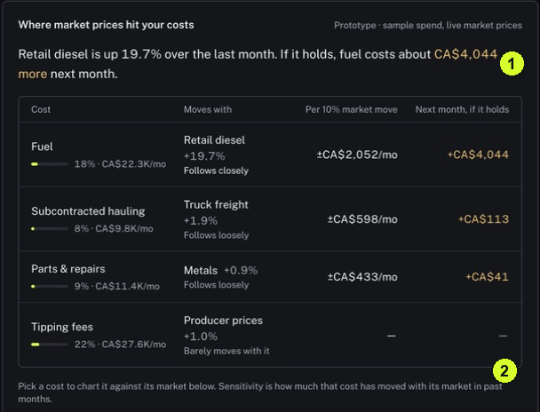

It can help you form a question about cost changes, but you need to understand what data a view uses before applying it to your organization.

<Tip>
**Example:** A diesel price increase may prompt a question about fuel costs. A view using sample spending cannot tell you your actual fuel bill.
</Tip>

<Info>
**Before you start:** Know whether you want market context or an answer about your own records. A prototype label indicates a developing feature.
</Info>

<Frame caption="1 Read the prototype and sample-spend qualification. 2 Review how sensitivity is described.">
  
</Frame>

## Step by step

1. Click Explore in the sidebar.
2. Choose Market events, AI insights or News according to the question you want to investigate.
3. Read the scope labels before using a figure. The illustrated comparison says Prototype • sample spend, live market prices.
4. Check the selected cost, market series and date range. Read the explanation of sensitivity, which describes how the cost has moved with the market.
5. If a chart is indexed, interpret it as change from a baseline. Do not read an index value as a currency amount.
6. Use Ask Gia for a focused follow-up about your own period and sources, then open the evidence it provides.

<Check>
**Expected result:** You can explain whether a displayed trend uses sample inputs or your own information and what question it helps you investigate.
</Check>

<Warning>
**If you get stuck:** If an insight remains loading, return later or investigate through Accounts and Records. Do not treat an incomplete panel as a finished finding.
</Warning>

<Note>
The comparison is labelled Prototype with sample spend and live market prices. It is not a verified forecast of your costs.
</Note>
