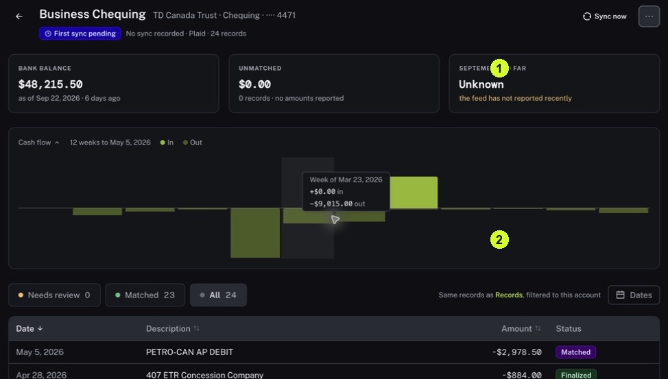

Use it to locate money coming in or going out, confirm which account it belongs to and check how current the information is.

<Tip>
**Example:** A supplier says it was paid last week. Look in the relevant bank account and date range, then compare the payment's date, amount and description.
</Tip>

<Info>
**Before you start:** Know the bank account and approximate date you want to check. A positive or negative sign describes the direction of an amount; compare it with the source.
</Info>

<Frame caption="1 Read the freshness messages and balance date. 2 Narrow the list with status and date controls.">
  
</Frame>

## Step by step

1. Click Accounts in the sidebar. Find the account using the institution, account name and masked number, then click it.
2. Read the balance date and sync message. Sync means bringing information in from the source. No sync recorded, First sync pending or Unknown is not a zero balance.
3. Open Dates and choose the period you need. Read the selected period after applying it.
4. Choose All to inspect all activity in that scope, or use Matched or Needs review to narrow the list. These labels describe different views of the work.
5. Find the item and compare its description, date, amount, currency and money direction with the bank source.
6. For records associated with this account, use its Records shortcut. For activity across accounts, click Accounts again and open Bank activity; Search transactions and With alerts can help narrow that view.

<Check>
**Expected result:** You can identify the account, period and source of the payment you are checking.
</Check>

<Warning>
**If you get stuck:** If it is missing, check Dates and status filters, then the latest sync message. Ask about import coverage if it exists at the bank but still does not appear.
</Warning>

<Note>
Export CSV produces a file for use outside Nini. Confirm the selected scope before using it.
</Note>
