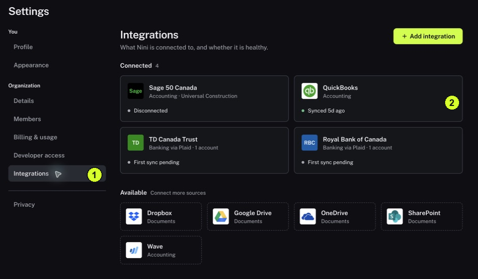

This helps explain whether missing information is a connection problem or simply outside the dates and filters you selected.

<Tip>
**Example:** Yesterday's transactions are absent. A disconnected bank source is a different problem from a healthy connection viewed with last month's date filter.
</Tip>

<Info>
**Before you start:** You need access to Settings. Read the connection state before changing anything.
</Info>

<Frame caption="1 Integrations sits within Settings. 2 Read the status of each connection card.">
  
</Frame>

## Step by step

1. Click Settings → Integrations and find the source under Connected.
2. Read the card's sync message, such as Synced with an elapsed time, pending or an error. The presence of a card is not proof of a successful current sync.
3. Open the connection to inspect the displayed source or company identity. Confirm that it is the one you intended to use.
4. Return to Recent activity and read the latest result for that provider. Distinguish a successful recent sync from an old successful event followed by an error.
5. Open a known imported item in Accounts, Documents or Records as appropriate. Compare its reference, date, amount, currency and counterparty with the source.
6. If the item is missing, check the date range, filters and supported coverage. Record the exact message and last successful sync time for your administrator.
7. Use a displayed reconnect or retry action only when the connection owner understands what it will do. Do not create a duplicate connection to make a missing item appear.

<Check>
**Expected result:** You have checked both the connection's status and a representative imported item.
</Check>

<Warning>
**If you get stuck:** If Integrations is absent, ask an administrator to inspect it. Follow the provider's agreed recovery process for Add integration, Connect bank, Connect accounting or Sync now.
</Warning>
